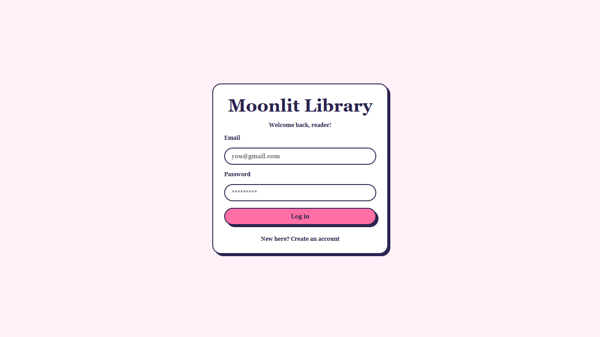
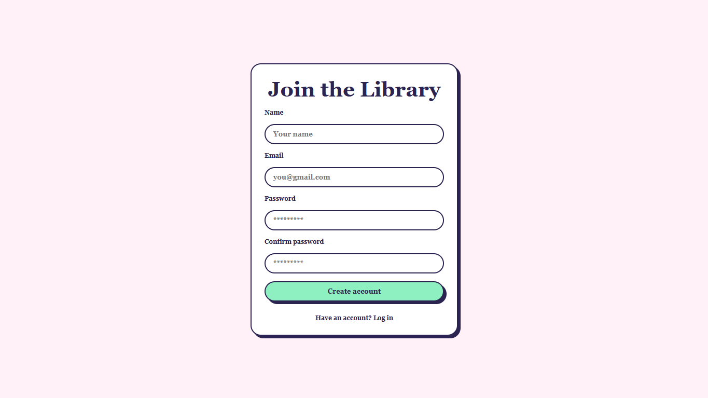
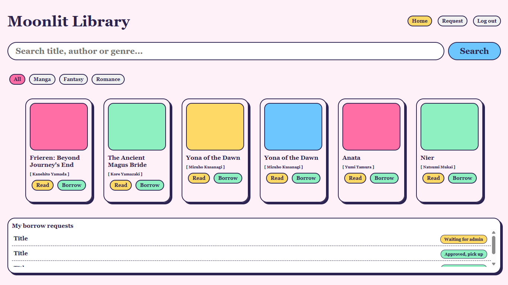
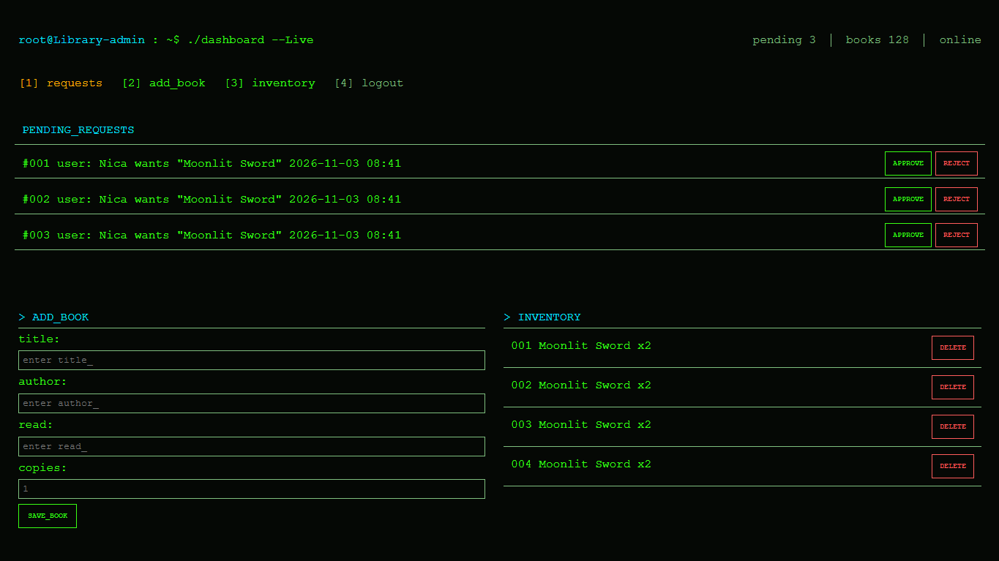

# Moonlit Library

A fullstack library management app built with **Node.js**, **Express**, and vanilla **HTML, CSS, and JavaScript**. It is a learning project, built step by step to practice backend fundamentals.

> **Status:** work in progress.

## Screenshots

| Login | Create account |
|---|---|
|  |  |

| Reader page | Admin dashboard |
|---|---|
|  |  |

## Features

### Reader side (`client.html`)
- Log in or create an account
- Browse the book list, loaded from the server
- Search by title, author, or genre
- Filter by genre (All, Manga, Fantasy, Romance)
- Send a borrow request with the **Borrow** button
- "My borrow requests" list shows the books you asked for
- Book and request lists refresh themselves every 5 seconds
- **Read** button (interface only, not connected yet)

### Admin side (`admin.html`)
- Terminal-style dashboard
- Add a book with title, author, description, and genre
- Delete a book from the inventory
- Inventory loads from the server and refreshes every 5 seconds
- Admin-only routes reply `403` to anyone who is not logged in as admin
- Pending requests with Approve and Reject buttons (interface only, not connected yet)

### Other
- Custom 404 page (`error.html`), not served by the server yet

## Tech stack

| Layer | Technology |
|---|---|
| Server | Node.js, Express 5 |
| Client | HTML, CSS, vanilla JavaScript (`fetch`) |
| Storage | JSON files |

## Project structure

```
Library-System/
  app.js               Express server and API routes
  package.json
  books.json           Books (not tracked by Git)
  accounts.json        Accounts (not tracked by Git)
  borrowedBooks.json   Borrow requests (not tracked by Git)
  localUser.json       Last logged-in reader (not tracked by Git)
  login.png            Screenshot: login page
  signup.png           Screenshot: create account page
  reader.png           Screenshot: reader page
  admin.png            Screenshot: admin dashboard
  public/
    index.html         Login and create-account page
    script.js          Login and create-account logic
    client.html        Reader page
    client.js          Reader page logic
    style.css          Reader and login styles
    admin.html         Admin dashboard
    admin.js           Admin page logic
    admin.css          Admin styles
    error.html         404 page
    error.js           404 page logic
    error.css          404 page styles
```

## Getting started

**Requirements:** Node.js 22 or newer.

```powershell
git clone https://github.com/Vince-Walll/Library-System.git
cd Library-System
npm install
```

Create these data files in the project folder, saved as **UTF-8**.

`books.json`
```json
[]
```

`borrowedBooks.json`
```json
[]
```

`accounts.json`
```json
[
  { "name": "Admin", "email": "admin@gmail.com", "password": "admin" }
]
```

`localUser.json`
```json
{}
```

The server treats the account with the email `admin@gmail.com` and the password `admin` as the admin. This is hardcoded in `app.js` for now (see Known issues). `POST /borrow` needs both `books.json` and `borrowedBooks.json` to exist.

Start the server:

```powershell
node app.js
```

Then open `http://localhost:3000`.

## Data format

A book in `books.json`:

```json
{
  "title": "Nier",
  "author": "Natsumi Mukai",
  "genre": "Manga",
  "read": "A short description of the book.",
  "available": true
}
```

A request in `borrowedBooks.json`:

```json
{ "user": "nica", "title": "Nier", "adminApproval": false }
```

## API

| Method | Path | Body | Description |
|---|---|---|---|
| POST | `/log-in` | `email`, `password` | Replies with `found` and `admin`, or an error |
| POST | `/create-account` | `name`, `email`, `password`, `password2` | Creates a reader account, `409` if the email exists |
| GET | `/books` | | List all books |
| POST | `/books` | `title`, `author`, `read`, `genre` | Add a book (admin only, `403` otherwise) |
| DELETE | `/books/:title` | | Delete a book by title (admin only, `403` otherwise) |
| POST | `/borrow` | `user`, `title` | Request a book, only if it is available |
| GET | `/borrowedBooks` | | List all borrow requests |
| GET | `/getCurrentUser` | | Return the last logged-in reader |

Other methods on `/books` and `/create-account` reply with a JSON `405`.

## Borrow flow

Current behavior:

```
Borrow clicked -> book becomes unavailable -> request saved with adminApproval: false
```

Planned behavior:

```
available -> requested -> borrowed
                 |
                 +-> rejected -> available
```

## Known issues

- **Login state is shared by everyone.** The admin flag is a single variable in `app.js`, and the current reader is stored in `localUser.json`. When one person logs in, it changes the state for every other visitor. Real sessions or tokens are needed.
- **Some routes have no protection.** `POST /borrow` trusts the `user` sent by the browser, and `GET /borrowedBooks` is open to anyone. Anyone can also open `/admin.html` by URL.
- **Passwords are stored as plain text** and need hashing before any real use.
- **Admin dashboard is partly placeholder.** The pending requests, `pending 3`, and `books 128` are static text, Approve and Reject do nothing, and the page has no logout control.
- **The inventory shows `x undefined`.** The admin list still prints `copies`, but books no longer have that field.
- **Request status never changes.** Every request shows "Waiting for admin", and the Borrow button still appears on books that are unavailable (the server rejects them).
- **The Read button does nothing.**
- **The 404 page is not connected.** Unknown URLs get Express's default error page instead of `error.html`.
- **Status codes are inconsistent.** Many errors reply `401`, and successful reads reply `201`. They should be `400`, `404`, `409`, and `200` where they fit.
- **The duplicate title check is case-sensitive**, so `Nier` and `nier` count as different books.

## Roadmap

- [x] Server-side login check
- [x] Book list loaded from the server
- [x] Add and delete books (admin)
- [x] Admin-only guard on book routes (`403`)
- [x] Auto-refresh the book and request lists
- [x] Search and genre filters
- [x] Send borrow requests
- [ ] Approve and reject requests (admin)
- [ ] Show the real request status to the reader
- [ ] Sessions or tokens, and protected routes
- [ ] Hash passwords
- [ ] Read button
- [ ] Serve the custom 404 page
- [ ] Clean up status codes
- [ ] Move storage from JSON files to SQLite

## What I learned

Routing, status codes, request and response bodies, validation, persistence, Express middleware, and connecting a frontend to a backend with `fetch`.
